# TrajectoryBot: differentiable-simulation RL for orbital maneuvers

TrajectoryBot is an orbital-dynamics stack written from the RK4 integrator up
(no Basilisk, no poliastro), and a policy-gradient agent that learns spacecraft
maneuvers by backpropagating through the physics. Results are benchmarked
against analytic transfers, and every claim is re-verified at high fidelity
before publication.

<p align="center">
  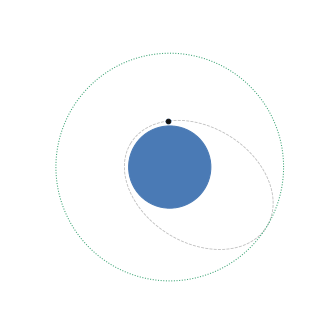
</p>

Every 200 s the policy, a tanh MLP, picks a thrust direction and throttle;
classical attitude control executes the burn.

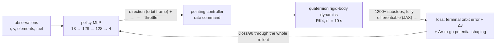

Sampling the trained policy's commanded thrust around an orbit, and measuring
which inputs move the throttle, shows that without being told it rediscovered
the textbook maneuver: coast, then burn prograde at apoapsis. Its throttle keys
almost entirely on radius error.

<p align="center">
  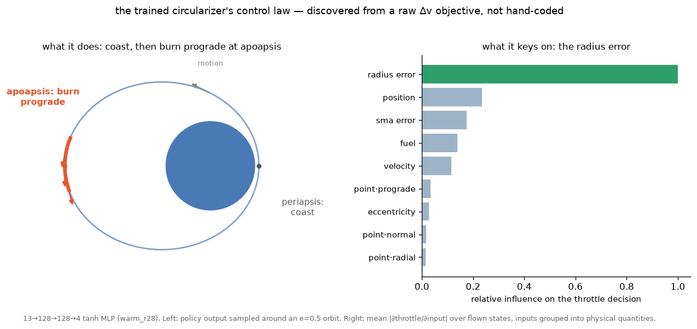
</p>

## Verified results

<p align="center">
  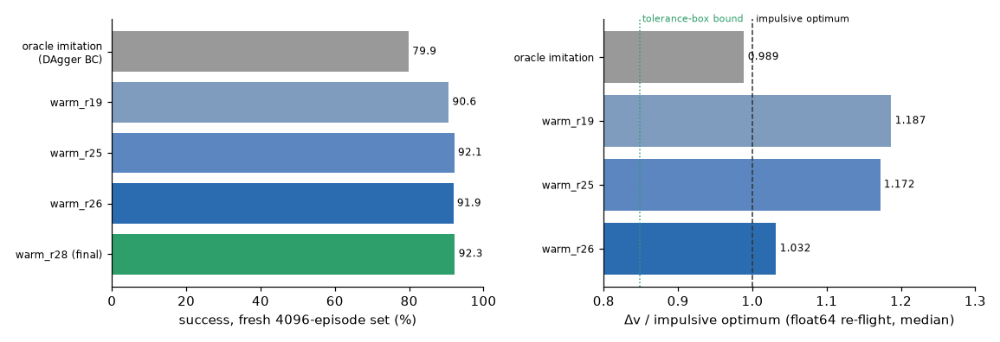
</p>

| Claim | Number | Verification |
|---|---|---|
| Success (5% tolerance terminal set, 3D) | **92.3%** | fresh 4096-episode set, never in-run telemetry |
| Fuel vs the impulsive analytic optimum | **1.03× median** (best-fuel policy, ~92% success) | float64 re-flight at dt = 1 s, clean episodes only, closed-form baseline (`scripts/verify_probe.py`) |
| Expert it improves on | scripted analytic expert imitated at 79.9% | same fresh set |
| Sim gaming ruled out | 0 of 4096 episodes beat the admissible tolerance-box bound | same probe, both baselines |

With closed-loop attitude and finite burns, the policy matches the analytic
fuel cost but does not beat it yet. The tolerance box admits solutions up to
~15% cheaper than exact circularization; reaching them is open work. The
verification harness audits integrator energy, excludes the clamp region, and
uses per-geometry closed-form baselines.

The headline policy circularizes at its own apoapsis; success falls to ~18% once the commanded target leaves that radius.
The cause is its imitation source, a fixed-target expert that never
demonstrated tracking; network capacity and optimization were not at fault.
DAgger from a two-apse tangential expert that drives both apses to the
commanded radius trains the same network shape to ~99% for radii within ±15%
of apoapsis on fresh 4096-episode sets
([`scripts/dagger_target_jax.py`](scripts/dagger_target_jax.py)).

<p align="center">
  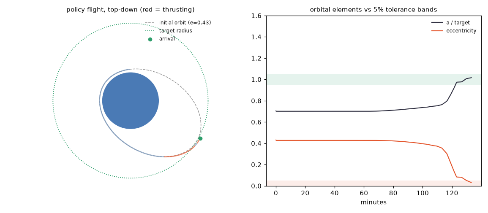
</p>

The final policy solves the start-orbit distribution. The figure colors 40 random start orbits flown by the final policy by whether
they finished inside the 5% box.

<p align="center">
  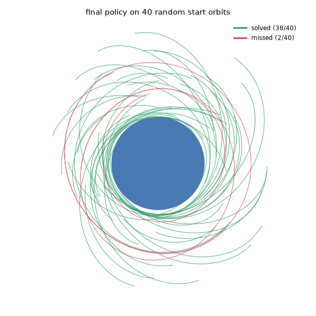
</p>

## Differentiable simulation vs model-free RL

In the 2-D milestone, with every method in one environment, model-free RL
stalled at 0-3% success over 8 runs. Differentiable-simulation policy
gradient, which uses the known and exactly differentiable dynamics, did an
order of magnitude better:

| Method | Success | Δv vs optimal |
|---|---|---|
| Scripted analytic expert | 100% | 1.00 |
| Cold PPO (model-free, 8 runs) | 0-3% | n/a |
| Behavior cloning | ~16% | ~1.37 |
| DAgger | ~45% | ~1.5 |
| **Differentiable-simulation policy gradient** | **81%** | 1.26 |

In 3-D, refinement rises above the imitated expert (one checkpoint per point,
fresh 4096-episode sets).

<p align="center">
  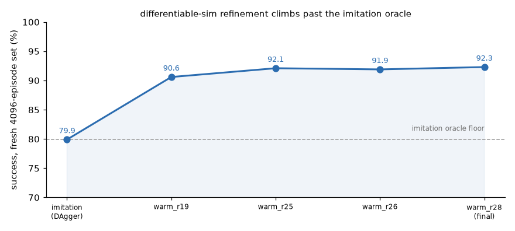
</p>

The 3-D trainer (`scripts/jaxsim.py`) runs `lax.scan` + `jit(value_and_grad)`
over the full 1200-substep rollout in JAX/XLA and matches the torch reference
exactly at ~50× the speed on a consumer GPU.

## Heavy-tailed gradients

About one episode in a few hundred has a gradient norm of 1e12 to 1e19
(finite, not NaN), and one Adam step on it can cost 12 points of success.
Reaching a stable 92% from 80% imitation took 30+ pre-registered rounds of
optimizer analysis.

<p align="center">
  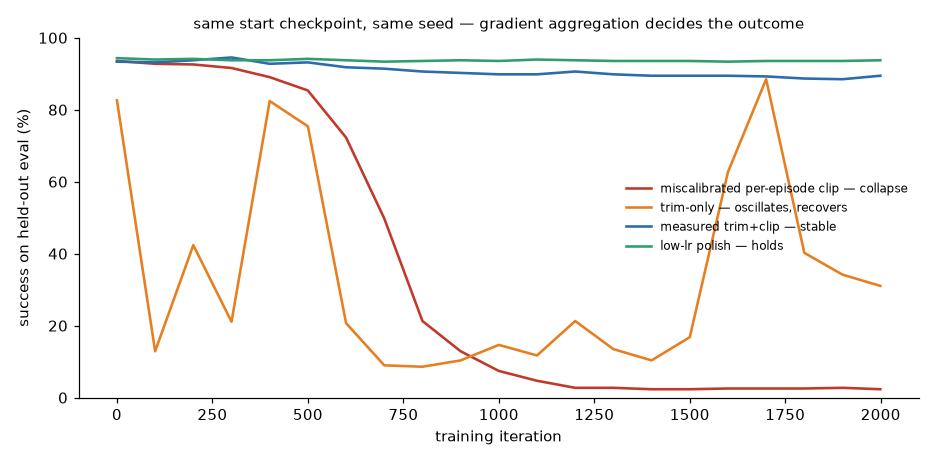
</p>

The runs share a start checkpoint and seed and differ only in gradient
aggregation. The animation flies one start orbit at four training
stages.

<p align="center">
  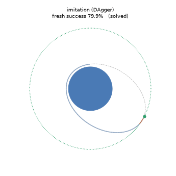
</p>

Final training trims the extreme tail of per-episode gradient norms, clips the
rest at the measured p90, keeps an exponential moving average of the policy,
and ends at a low learning rate. [`docs/EXPERIMENTS_3D.md`](docs/EXPERIMENTS_3D.md)
(3-D, rounds logged verbatim) and [`docs/EXPERIMENTS.md`](docs/EXPERIMENTS.md)
(2-D) list the failure modes: short-horizon truncation bias in backpropagation
through time, absorbing-state mismatches, potential shaping that rewarded zero
progress, and a normalize-epsilon that produced 1e6 gradients at every coast
decision.

## Lunar capture and J2 phasing

### Ballistic capture at the Moon (CR3BP)

A transfer seeded on the stable manifold of an L2 Lyapunov orbit arrives bound
to the Moon (negative Moon-relative energy) without a capture burn and stays
4.6 lunar revolutions (~26 days, verified at dt = 5e-5). A naive departure-burn
search finds no capture. The Earth-Moon CR3BP conserves the Jacobi constant to
~1e-7; the manifold comes from the Lyapunov orbit's monodromy matrix
(symplectic, det = 1). The model is idealized and does not use JPL ephemerides
yet.

<p align="center">
  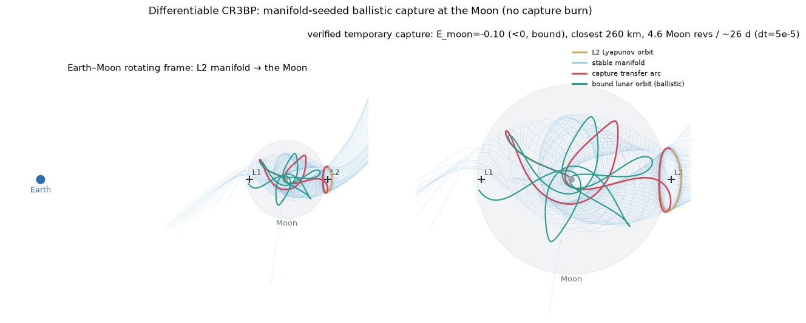
  <br/>
  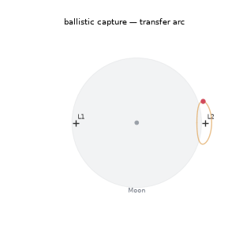
</p>

### J2 nodal-drift phasing

Trained only on true Δv for a RAAN (orbital-plane) change under J2, the policy
drops to a lower altitude, where the node drifts faster at no Δv cost, and
then returns. It needs ~0.88× the Δv of
passive waiting at 30° and a quarter to a half of it at 60-90°. It does not
beat an analytic optimization of the same plan, which is ~10-15% cheaper. Like
the raise-to-plane-change result elsewhere in the project, it rediscovers a
known technique from the raw objective.

Low-thrust Δv is idealized (impulsive per step), and each build records where
the savings vanish: small node angles, and budgets long enough that passive
waiting is free.

<p align="center">
  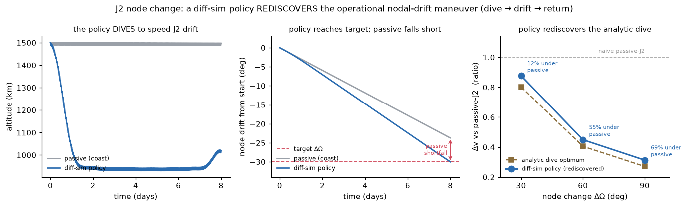
</p>

## Gravity assists in the real solar system

Backpropagation through a JAX rollout under many point-mass bodies placed by
JPL Horizons gives `∂(miss distance)/∂(maneuver)`. Offline checks precede
any claim: the two-body Kepler limit closes to `|Δr|/a = 9e-13`, energy holds
to `7e-15`, and the optimizer, started at `Δv = 0`, recovers the Lambert
transfer to `1.2e-11` relative error. Bodies held fixed within each RK4 step
are accurate at heliocentric scale; close geocentric orbits (Earth moves
~9000 km per step) use substep interpolation.

<p align="center">
  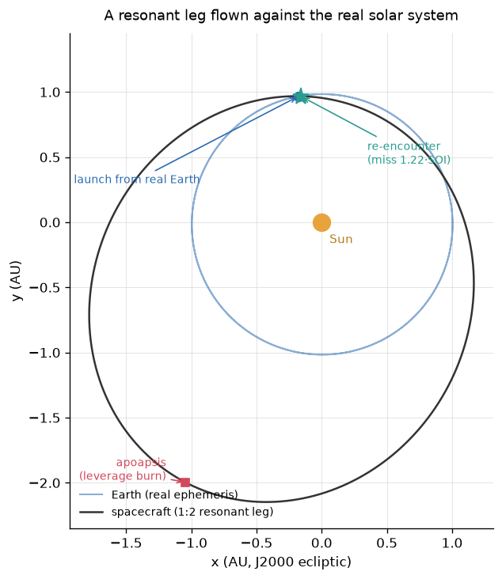
</p>

### Inclination ceiling

Gravity assists alone reach inclinations up to `arcsin(v∞/v_P)`, for
hyperbolic excess speed `v∞` and planet orbital speed `v_P`, independent of
planet mass. Repeated flybys of one body at fixed `v∞` (the crank) climb to
the ceiling. A heavier or closer planet bends the velocity more per pass:
Jupiter needs one flyby, Venus about five. The Venus tour reaches 32.8° of a
32.9° ceiling; Solar Orbiter used ~7-8 Venus assists to reach ~33°. The
design condition is `v∞ ≥ v_P·sin(i)`: a polar orbit needs `v∞` at
least the planet's orbital speed.

The backprop optimizer is never told about leverage or cranking. Starting
from zero leverage with only a target inclination and a Δv objective, it finds
the textbook gravity-assist plan: it cranks below the ceiling and pumps `v∞` first
(`V∞-leveraging`) above it, within 1% of the analytic budget. The resulting plane change costs 2-12×
less Δv than a direct one; the high end needs favorable
leverage.

<p align="center">
  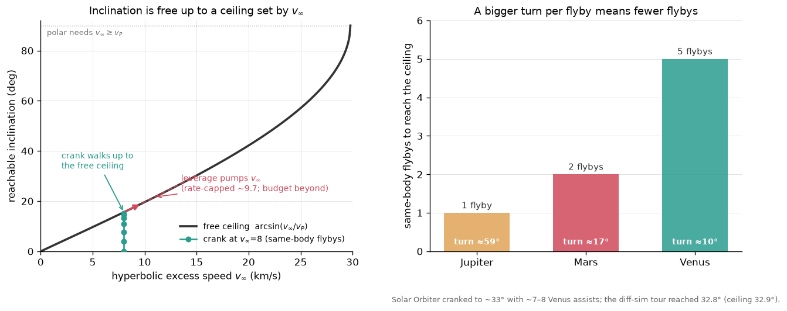
</p>

### Leverage and the SOI pump cap

On the real ephemeris, an apoapsis burn changes `v∞` at the next Earth
encounter by a factor L ≈ 15-37: 5 m/s gives ~75 m/s of `v∞`, and the return
misses Earth. Keeping the re-encounter inside Earth's sphere of influence (SOI)
caps the pump near 0.085 km/s of `v∞` per leg. With one planet, `v∞` climbs
from 8 to ~9.7 km/s over ~18 legs and then stops.

Successive rounds found that the pump survives
the real ephemeris per leg (an earlier negative reading used a burn
~20× too large), that every resonance gives the same ~0.1 km/s per leg, and that one
apoapsis burn can't both pump `v∞` and re-aim the encounter. Bending the flyby
can't fix the return: it sets the outgoing orbit before the burn de-phases
the return.

A correction after the burn breaks the cap but trades Δv one-for-one. A
second planet avoids that trade: inner planets pump faster, and the handoff conserves the Tisserand parameter at no
cost.

<p align="center">
  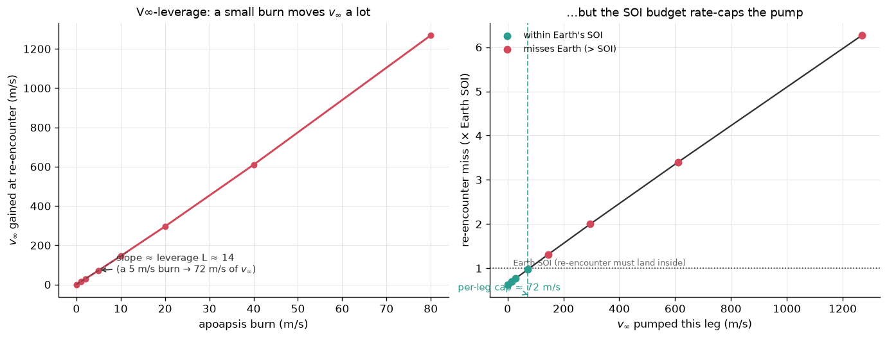
</p>

### Forward propagation

Lambert legs fail near resonant returns, where gradients exceed `1e18` and the
optimizer reports very high `v∞` while violating flyby physics. A
differentiable Kepler propagator carries each leg forward instead, and each flyby is a bounded rotation of `v∞` that
conserves `|v∞|` exactly, so no flyby constraint is left to
cheat. Gauss-Newton closes encounters to meters on the real ephemeris, and
gradients flow end to end.

### Pump-and-crank tour

From a 5.95 km/s launch, tree search reaches `v∞ = 16.3 km/s` in four
ballistic pumping flybys of Venus and Earth. Five more Venus flybys raise
inclination from 1° to 27.1° (97% of the ceiling). Re-hitting the moving
planet pins about half of each turn, so the crank needs ~5 flybys against an
ideal ~2. The result does not depend on a lucky launch date. Of eight launch
epochs over two synodic cycles, five pump to 15-18 km/s (median 15.3), two
have no viable cheap launch, and one launches but never climbs.

<p align="center">
  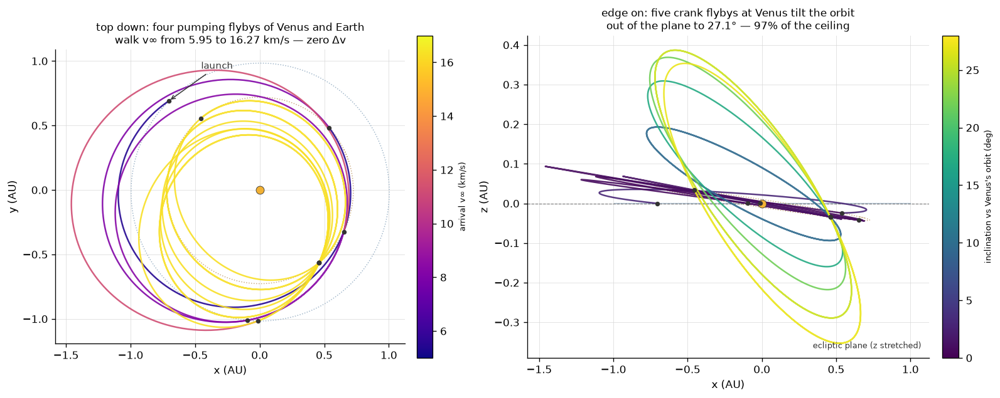
</p>

<p align="center">
  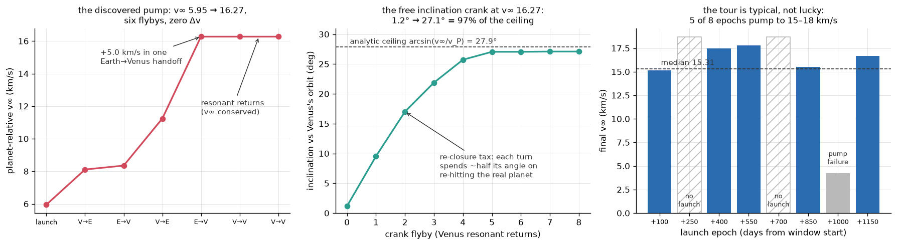
</p>

The gravity-assist study is patched-conic and studies mechanism; it sets no Δv
record. The pre-registered method and verdicts, including the rounds that overturned
earlier conclusions, are in
[`docs/ROADMAP.md`](docs/ROADMAP.md).

## Quickstart

```bash
uv sync --extra dev            # Python 3.12+, from pyproject/uv.lock
uv run pytest                  # physics, baselines, envs, solvability
uv run pyright                 # strict typing on the shipped library

# 2-D milestone (torch)
uv run python scripts/train_circularize2d.py

# 3-D JAX training run (GPU; CPU works, slower)
uv run --with "jax[cuda12]" python scripts/jaxsim.py \
  --init models/dagger_jax.npz --iters 3000 --chunk 60 --lr 1e-4 \
  --absorb --phi-dv --d-eps 1e-4 --trim-ep 16 --clip-ep 20000 --ema 0.995

# verify a fuel claim at high fidelity (float64, dt=1 s, both baselines)
uv run --with jax python scripts/verify_probe.py models/<ckpt>.npz

# regenerate the README figures
uv run --with jax --with matplotlib --with pillow python scripts/viz_readme.py models/<ckpt>.npz <logdir>
uv run --with jax --with matplotlib --with pillow python scripts/viz_readme_extra.py  # progression / weights / generalization / learning gif
uv run --with jax --with matplotlib --with pillow python scripts/viz_tier3.py          # CR3BP capture + J2-beat frontier (no checkpoint needed)
uv run --with jax --with matplotlib --with pillow python scripts/viz_lowthrust.py # low-thrust spiral (flies the E1 lt_2e-4 specialist)
uv run --with jax --with astroquery --with astropy --with matplotlib python scripts/viz_campaign.py  # N-body ephemeris tour + inclination ceiling + leverage cap (needs .ephem_cache)
```

Training regenerates checkpoints and run logs, which are not committed. The
circularize-lineage checkpoints behind the figures are in a
[GitHub release](../../releases/tag/readme-checkpoints).

## Repository map

| Path | Contents |
|---|---|
| `tbot/` | Library: quaternions, 2-D/3-D dynamics, orbital elements, attitude controller, Gymnasium envs; pyright-strict. |
| `scripts/jaxsim.py` | 3-D JAX/XLA differentiable-simulation trainer used for the research runs. |
| `scripts/verify_probe.py` | float64, dt=1 s claim-verification harness (exact + tolerance-box baselines). |
| `scripts/eval_probe.py`, `norm_probe.py`, `step_probe.py`, and others | Optimizer-analysis measurements. |
| `ephemeris.py`, `scripts/nbody_sim.py`, `scripts/full_ephemeris_tour.py`, `leverage_anatomy.py`, `resonance_hopping.py`, `flyby_leverage.py` | N-body / JPL-ephemeris engine and gravity-assist study; `--verify` runs offline on the cached ephemeris. |
| `docs/EXPERIMENTS_3D.md`, `docs/EXPERIMENTS.md` | 3-D optimizer campaign; 2-D milestone methodology. |
| `docs/ROADMAP.md`, `docs/AUDIT.md` | Target maneuvers, gravity-assist campaign log, audit of the 2021 code. |
| `docs/GRAVITY_ASSIST.md` | Gravity-assist summary (inclination ceiling, v∞-leverage, SOI pump cap). |
| `v2/`, `archive/` | The 2021 course project, kept as the "before" state (excluded from CI/typing). |

## Roadmap

- Circularize (3-D): done.
- Plane change: done.
- Low-thrust Edelbaum spiral: done.
- Ballistic lunar capture in the CR3BP: done.
- N-body engine on JPL Horizons and gravity-assist study: done.
- Correctly timed leverage correction and a multi-planet tour: open.
- Benchmark against historically flown trajectories.

N-body fuel comparisons span solar-system phases because syzygy effects depend
on the epoch. Gravity-assist missions test whether the agent can discover an
assist and are not used as Δv targets.

## Provenance

TrajectoryBot began as a 2021 graduate astrodynamics course project that
trained but never converged ([`docs/final-report.md`](docs/final-report.md),
`v2/`, `archive/`). The revival started with an audit of why it failed
([`docs/AUDIT.md`](docs/AUDIT.md)).

MIT licensed. [CONTRIBUTING.md](CONTRIBUTING.md) describes how changes are
evaluated (pre-registered experiments, verification-fidelity claims).
